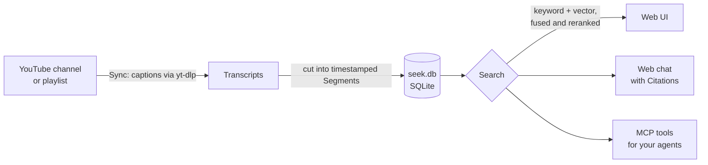

<p align="center">
  <picture>
    <source media="(prefers-color-scheme: dark)" srcset="docs/brand/seek-logo-accent-dark.svg">
    
  </picture>
</p>

<p align="center">
  <strong>Ask the YouTube channels you learn from. Every answer cites the moment it was said.</strong>
</p>

<p align="center">
  
  
  
</p>

---

Seek turns YouTube channels into a knowledge base you can question. Add the channels you learn from (woodworking,
positioning, TypeScript, whatever you watch to get better at something), let Seek read every video's transcript, and
then ask in plain language. Search goes by what was actually *said*, not by titles, tags or descriptions. Every answer
links back to the exact timestamp, with frames of what was on screen, so you can check the advice against the source.

Everything runs on your machine: the transcripts, the search index, and the models that read them. You can ask in the
web UI, or give your coding agents (Claude Code, Codex) the same library over MCP.

## Contents

- [What it does](#what-it-does)
- [How it works](#how-it-works)
- [Install](#install)
- [First run](#first-run)
- [Upgrade](#upgrade)
- Reference: [Checking for new videos](#check-for-new-videos-automatically-or-from-the-command-line) ·
  [Status and diagnostics](#check-on-it-from-the-command-line) ·
  [Sharing (Export, import, `seek export`, `seek import`)](#sharing-a-channel-or-playlist) · [Data](#data) · [Configuration](#configuration) ·
  [Reverse proxy](#publishing-through-a-reverse-proxy) · [Agents (MCP)](#register-seek-with-your-agents) ·
  [Settings](#settings) · [Web chat](#web-chat) · [Troubleshooting](#troubleshooting) · [Development](#development)

## What it does

- **Search by meaning, across hours of video.** Ask "how do I flatten a workbench top?" and get the passages where
  someone explains it, even if they never used those words.
- **Answers you can check.** The web chat answers from your channels and cites the moments it draws on, as
  timestamped links. The sources panel shows frames from each cited moment.
- **Group what belongs together.** Put channels into Groups ("woodworking", "pricing") and ask a whole Group at once,
  or just one channel.
- **Follow a playlist.** Add a YouTube playlist, yours or anyone's, and ask it on its own. Each video stays credited
  to the channel that made it, and the Playlist keeps in step with YouTube: videos added there are added, videos
  removed there are removed.
- **Prefer what's current.** Advice ages. Searches can gently or strongly favour newer videos.
- **Bring it to your agents.** Seek is an MCP server, so Claude Code or Codex can search your library while they work.
- **Keyless by default.** Search, the Library, Syncs and the MCP tools need no account or API key. Only the web chat
  needs an engine: an Anthropic API key, or Claude Code logged in to your subscription.

## How it works



A **Sync** lists a channel's or a playlist's videos, fetches their captions, and cuts each transcript into timestamped Segments. A local
embedding model ([Qwen3-Embedding-0.6B](https://huggingface.co/Qwen/Qwen3-Embedding-0.6B)) turns each Segment into a
vector. Search combines full-text and vector matches, then a local reranker
([mxbai-rerank-base-v2](https://huggingface.co/mixedbread-ai/mxbai-rerank-base-v2)) puts the best first. Everything
lives in one SQLite file. The models run on an NVIDIA GPU when there is one, on Apple Silicon's GPU on a Mac, and on
the CPU otherwise.

## Install

Seek installs from this repository with [uv](https://docs.astral.sh/uv/) and runs in a terminal.

> [!NOTE]
> **Linux** is the tested platform. **macOS on Apple Silicon** is supported, but it hasn't been verified on real Mac
> hardware yet. Windows isn't supported.

### 1. Check the prerequisites

| Tool | Why | Check | Install |
| --- | --- | --- | --- |
| [uv](https://docs.astral.sh/uv/) | Installs Seek, and fetches Python 3.13 for it if you don't have it | `uv --version` | `curl -LsSf https://astral.sh/uv/install.sh \| sh` (macOS: or `brew install uv`) |
| [Node](https://nodejs.org) 22.12+ | Builds the web UI during install | `node --version` | [nodejs.org](https://nodejs.org), `brew install node`, or [nvm](https://github.com/nvm-sh/nvm) |
| [pnpm](https://pnpm.io) | Same | `pnpm --version` | `corepack enable` (ships with Node), or `brew install pnpm` |
| [Deno](https://deno.com) | yt-dlp needs it to solve YouTube's JavaScript challenges | `deno --version` | `curl -fsSL https://deno.land/install.sh \| sh` (macOS: or `brew install deno`) |
| git | Fetches this repository | `git --version` | Usually present. On macOS, `xcode-select --install` |

Each one takes a minute or two to install. Optionally, for the web chat, install
[Claude Code](https://claude.com/claude-code) and log in, or have an
[Anthropic API key](https://console.anthropic.com/settings/keys) ready. Seek works without either.

### 2. Install Seek

```sh
uv tool install git+https://github.com/ariviom/seek
uv tool update-shell   # once, if ~/.local/bin isn't on your PATH yet
```

The install builds the web UI, so the first one takes a few minutes. Check it with `seek --help`.

### 3. Start it

```sh
seek serve
```

Seek prints its address (normally <http://127.0.0.1:7337/>). Wait for Uvicorn's line saying it's listening, then open
the address in your browser. **Closing the terminal stops Seek**; so does Ctrl+C. On first start it creates its config
and data directories, and keeps any that already exist.

The first start also downloads the two models into the Hugging Face cache (`~/.cache/huggingface`, or `HF_HOME`),
about 2.2 GB. The dot at the foot of the left rail shows their progress: hover it for the reason, click it for the
details. After that, Seek starts and searches offline. Syncing and the web chat still need a connection.

### Optional: run it as a Linux service

On Linux, Seek can run in the background and start at login instead. Run `seek install-service` from an ordinary
terminal (not an editor or agent session, whose PATH the service would copy).

`seek install-service` writes `~/.config/systemd/user/seek.service`, enables it, starts it, and waits until the server
answers on <http://127.0.0.1:7337/>. From then on it starts whenever you log in. To start it at boot without logging in, run
`loginctl enable-linger`. To run it in the foreground instead, use `seek serve`. Off Linux, `install-service` refuses
and points to `seek serve`, and Sync is manual, from the web UI or `seek sync`.

The unit records the `seek` you ran and the PATH of the shell you ran it from, so the service finds `deno` the same
way you do. Unless `claude_cli_path` is configured, it also records the first `claude` on that PATH as it appears
there (for a standard install, the `~/.local/bin/claude` link, which survives Claude Code updates). It also copies any
`SEEK_*` variables that are set, plus `HF_HOME`, `HF_HUB_CACHE`, `CUDA_VISIBLE_DEVICES`, `CLAUDE_CONFIG_DIR`,
`XDG_CACHE_HOME`, `XDG_CONFIG_HOME`, and `XDG_DATA_HOME`. It records nothing else, and it removes any
`ANTHROPIC_API_KEY` from the service's environment, because the chat would bill that key instead of your subscription.
It warns if `claude` or `deno` can't be found.

Recorded variables override the config file, like any `SEEK_*` variable. That includes the recorded
`SEEK_CLAUDE_CLI_PATH`. Rerun `seek install-service` whenever they should change, including after you set
`claude_cli_path`. Other config file changes only need a restart: `systemctl --user restart seek`.

Status: `systemctl --user status seek`. Logs: `journalctl --user -u seek`.

## First run

1. **Add a channel.** Open **Library**, choose **Add channel**, and paste a channel's URL or `@handle`. Start with a
   small one, a few dozen videos: Seek fetches and indexes every video it finds, and YouTube limits how fast it can
   (roughly 300 videos an hour without a signed-in cookie file). A playlist is added the same way, from the
   Library's **Playlists** tab with **Add playlist** and its URL. If someone gave you a `.seek` file, either dialog
   imports it instead, already indexed: see [Sharing a Channel or Playlist](#sharing-a-channel-or-playlist).
2. **Watch it Sync.** **Syncs** shows each video as it becomes searchable, with the rate, an estimated finish, and any
   failures. You can close the tab: syncing carries on while Seek runs, and an interrupted Sync resumes where it
   stopped.
3. **Search.** Use **Search** as soon as the first videos are ready. Results link to the moment in the video.
4. **Set up chat (optional).** Open **Settings** (the gear) and either paste an Anthropic API key or check that Claude
   Code shows as ready. Then start a chat on a channel, Group or Playlist from the Library, and ask away. Answers cite the moments
   they draw on, and the chat shows the tokens each Conversation used.
5. **Connect your agents (optional).** Run `seek mcp-config` for the exact command, or see
   [Register Seek with your agents](#register-seek-with-your-agents). For Claude Code:

   ```sh
   claude mcp add --transport http --scope user seek http://127.0.0.1:7337/mcp
   ```

A Playlist's videos can come from channels you haven't added. Those creators are named on the Playlist's page and in
every result and citation, but they aren't Channels in your Library until you add them, which keeps the videos already
indexed. A video a Playlist includes is searchable even where its Channel's Filters would leave it out (the minimum
length still applies), and Search can cover one Playlist or everything, which includes every active Playlist. Pausing
a Playlist takes it out of searches of everything and stops its checks; a video an active Channel of yours also has
stays searchable.

**Remove playlist** on the Playlist's page deletes the Playlist and its Syncs, and each of its videos unless a Channel
in your Library or another Playlist still has it. Its chats stay readable but can't be continued. Removing a Channel
works the other way round: videos a Playlist includes stay, still credited to that creator, who is then no longer in
your Library.

If something looks wrong, `seek doctor` prints one block, with secrets redacted, to paste to whoever is helping.

## Upgrade

Stop Seek (Ctrl+C), reinstall from the repository, and start it again:

```sh
uv tool install --reinstall git+https://github.com/ariviom/seek
seek serve
```

`--reinstall` fetches the latest revision. Your config, knowledge base, preferences and stored key all stay where they
are. On macOS, the new install can trigger a keychain prompt to allow access to the stored key: choose **Always Allow**.
For a Linux service installation, run `seek install-service` instead of `seek serve`, which refreshes the recorded
environment and restarts the service.

## Check for new videos automatically or from the command line

While Seek runs, it checks each active Channel for new videos on its own: every 6 hours, daily or weekly, or not at
all, chosen under **Check for new videos** on the Channel's page. New Channels check daily, but only after their first
Sync, which you start: it ingests the whole catalogue, so set any Filters before it. A check is a
normal Sync, queued once the Channel's latest Sync was queued longer ago than its interval, and never while one is
already queued or running; like any later Sync it stops listing at videos Seek already knows (see below) and ingests
the new ones. Checks happen only while Seek is running, on macOS and Linux alike; any that came due while it was
stopped run as it starts. Pausing a Channel stops its checks without changing the setting, so resuming it restores
them.

A Playlist is checked the same way, under **Check for changes** on its page: daily unless you choose otherwise, and
only after the first Sync you start. Every Sync of a Playlist lists the whole playlist, ingests the videos new to it,
and drops the ones no longer there. If YouTube lists nothing at all for a Playlist that has videos, the Sync fails and
removes nothing.

To Sync without waiting for a check:

```sh
seek sync --all                           # every active Channel and Playlist
seek sync --channel "Wood By Wright"      # one Channel, by its YouTube name or channel id
seek sync --playlist "Sharpening picks"   # one Playlist, by its name or YouTube playlist id
```

Channels and Playlists are added in the web UI, from YouTube or from a
[Bundle](#sharing-a-channel-or-playlist), or imported from a Bundle with `seek import`; `seek sync` only Syncs what
the Library already has.

When the server is running, `seek sync` queues the Syncs there and returns; their progress and any failures show in
the web UI. When it isn't, `seek sync` loads the embedding model and runs the Syncs itself, returning when they finish
(it exits 1 if any failed). If the service is running but not answering yet, it waits up to 30 seconds for the server
first. Only one process runs Syncs at a time: a server started meanwhile waits for it, and a `seek sync` started
while another process runs Syncs waits for that process to run its Syncs too.

A Sync lists a Channel's videos and streams tabs (past livestreams included). Once a Channel has completed a Sync, later
Syncs stop listing at the first page of Videos already known, unless the Channel has a most-recent filter or the Sync
retries failures. A Video published in the last week without captions is retried by later Syncs, since YouTube may
still be generating them. When YouTube refuses the captions of three Videos in a row, the Sync stops and the failed
Videos wait for the next one; no Sync runs for `youtube_backoff_seconds`, doubling for each Sync in a row that stops so.

`seek reindex --all` (or `--channel`, or `--playlist`) Syncs the same way but first re-cuts and re-embeds every Video already indexed
from its stored Transcript, without fetching from YouTube again. Run it after upgrading to a Seek that indexes
passages differently; until each Video is done again it is out of search.

`seek backfill-storyboards` takes the same three targets and stores the frames of searchable Videos that have none
yet. It always runs in its own process, beside the server if one is running, and can be stopped and run again.

## Check on it from the command line

```sh
seek status   # the server, its models, both chat engines, and running and queued Syncs
seek list     # Channels, active or paused, with ready, failed, and excluded Videos and when each last synced; then Groups with their Channels; then Playlists, with the same counts and their creators
```

Both ask the running server. When none answers, they read the knowledge base instead: `seek status` then says the
server isn't running (only the server loads the models) and checks both chat engines itself.

When something is wrong, `seek doctor` prints one block to paste to whoever is helping: versions, platform, paths,
settings, each model's device and state, both chat engines, yt-dlp and JavaScript runtimes, the database's schema and
row counts, and the latest stored errors. The API key, YouTube extractor argument values and cookie settings are
redacted everywhere in it. Without a server it reads what it safely can and says what it couldn't; it never loads a
model, creates or migrates the database, or contacts a provider.

## Sharing a Channel or Playlist

Indexing is the slow part. A **Bundle** is a `.seek` file holding one Channel's or one Playlist's indexed Videos, so
someone else's Seek can have them without fetching or embedding anything. You make one and take one in from the web
UI, on whichever device you have it open, or with two commands on the machine Seek runs on.

**In the web UI.**

- **Export** is on a Channel's page and on a Playlist's, beside Pause. A dialog says how many indexed Videos go into
  the file, that it contains the creators' full Transcripts, and, for a Channel with a Playlist filter, that the
  filter is left out. Press **Export** there: Seek builds the Bundle ("Building…") and your browser downloads it as
  `<name>.seek`, with `_` in place of any character a file name can't hold. It works on a Paused entry and during a
  Sync, and is disabled on an entry with no indexed Videos. The built Bundle is downloaded once and then deleted from
  Seek's data directory, and one never collected is deleted ten minutes after it was built, or when Seek stops if
  that comes first; if a download breaks, export again.
- **Import** is in the **Add channel** and **Add playlist** dialogs, under the URL: choose **or import a `.seek`
  file**, pick the file, and press **Import**. Either dialog takes either kind of Bundle. There is no name to give:
  the entry takes the Bundle's, and you can rename it on its page. When "Importing…" ends, the dialog shows what
  `seek import` reports (below), with a **Start a Sync** button in place of the command to run next; the entry is
  selected in your Library, its Videos are searchable, and other open pages show it without a reload.

An import in the web UI follows the rules under **Importing** below, with these differences:

- **Not beside a Sync, queued or running.** While any Sync is running or waiting to run, the import path is disabled and says
  `A Sync is running or waiting to run; import when it has finished.` A Sync that is only queued (while the embedding
  model loads, or while Seek waits out a YouTube block) counts, where `seek import` is refused only by one that is
  running. A Sync you queue during an import starts as soon as the import ends.
- **One at a time.** A second import while one is uploading or importing is refused:
  `Another import is running; try again when it has finished.`
- **A name that is taken.** A Playlist whose name another of your Playlists has is refused with
  `A Playlist named '…' already exists; rename it, then import the file again.` Rename the one you have.
- **Up to 2 GB.** A file over 2 GB (2,000,000,000 bytes) is refused as you choose it, before anything is sent:
  ``The file is larger than 2 GB, the most the web UI imports; import it with `seek import`.`` The cap is fixed.
- **A proxy may refuse a large Bundle.** If you reach Seek [through a reverse proxy](#publishing-through-a-reverse-proxy)
  or a service such as Cloudflare, that may limit the size of an upload well below 2 GB, and turn a large Bundle away
  before Seek sees it. The dialog then says
  ``The file didn't reach Seek. A proxy in front of it may refuse a file this large; import it at `localhost` on the machine Seek runs on, or with `seek import`.``
  The file is fine: open Seek in a browser on the machine it runs on (`http://localhost:7337`, unless you changed
  the port) and import it there, or use `seek import`. Seek doesn't know your proxy's limit, so it says this only
  once a file has been turned away.
- **Closing the tab.** The dialog can't be dismissed while it imports. If the browser goes while the file is still
  being sent, the upload is discarded and nothing is imported. Once the whole file has reached Seek, the import
  finishes without the browser, and the entry appears on any open page.

**From the command line.**

```sh
seek export --channel "Wood By Wright" wright.seek     # one Channel, by its name or YouTube channel id
seek export --playlist "Sharpening picks" picks.seek   # one Playlist, by its name or YouTube playlist id
seek import wright.seek                                # add it to the Library, or top up the one already there
seek import picks.seek --name "Sharpening"             # ...under a name of your choosing
```

**What a Bundle holds.** The Videos that are searchable in that Channel or Playlist, Paused or not, each with its
details, Transcript, Segments, and vectors. A Channel's Bundle carries its name, avatar, date range, and most-recent
count; a Playlist's carries its name, each Video's place in it, and the creators its Videos are credited to. Left
out: excluded, failed, and unfinished Videos, storyboards, Pause state and check schedule, Groups, Conversations,
settings, and everything else in your Library. **A Channel's Playlist filter does not travel**, since it names a
playlist the recipient may not be able to list; export says so, and their Syncs bring in the Channel's other Videos
unless they set a Playlist filter of their own first.

**Size.** A Bundle is about 10 KB per Segment, 4 KB of it the vector and the rest the Transcript and the Segment's
text, so a Channel of 900 Videos is 150 to 250 MB. Export prints the Videos, Segments, and file size.

**Exporting** with `seek export` runs beside the server, even during a Sync, and loads no model. `.seek` is added to the path if
missing. It refuses to replace a file that exists and to write a Bundle with no indexed Videos, and never leaves a
half-written `.seek` file (a killed export can leave a `.tmp` file beside it). The Bundle is readable by you alone
until you change that.

**Importing** makes the Videos searchable at once, and loads no model. It can be the first thing a new install does,
in the web UI or with `seek import`, which runs with the server up or down. A server running beside `seek import`
isn't told: its pages show the new entry on their next load. The command's progress goes to stderr, and this report
to stdout:

```
Imported Wood By Wright: 212 Videos added, 0 already indexed, 3 left out.
  Shorter than the 120 second minimum: 3
It arrived with its filters: published from 2023-01-01, the 250 most recent.
The Bundle's text came from whoever made the file, and is only as trustworthy as they are.
Next, start a Sync to pick up the Videos published since: seek sync --channel UC-wright
```

A Playlist's report has the same counts, no filters line, and ends
`Next, start a Sync to pick up the Videos added to the playlist since: seek sync --playlist PL-picks`. **That Sync is
the next step either way**: the imported entry is an ordinary one, shown as never synced, and its automatic checks
begin after the first Sync you start. That Sync fetches only what is new.

- **Merging.** A Video you have already indexed is never touched. One you have but haven't finished (queued,
  part-way, or failed) is completed from the Bundle. So importing a newer Bundle of something you already have is a cheap top-up,
  and an interrupted import is simply run again: it keeps no progress record, and skips what is done.
- **Your settings win.** A Channel or Playlist already in your Library keeps its name and every setting
  (`It was already in the Library, and keeps its name and settings.`), so `--name` applies only when the import adds
  the entry. New Videos under your minimum length are left out, as are a Channel Bundle's new Videos outside the
  Channel's date range and any of its Videos your own Sync excluded or credits to another Channel; the report counts
  each reason. A Playlist's Videos are searchable whatever their Channels' filters, as with a Playlist you added, and
  creators you haven't added stay outside your Library.
- **Names.** A Playlist whose name another of your Playlists has is refused: `seek import` points at `--name`, and
  the web UI says to rename the one you have.
- **Syncs.** While a Sync is running, `seek import` is refused with
  `A Sync is running; run the import again when it has finished`; that includes up to 20 seconds after a server was
  killed mid-Sync. A Sync queued during a `seek import` waits, and starts within 5 seconds of the import ending. The
  web UI is stricter, as above.
- **Same embedding model.** A Bundle imports only into a knowledge base that uses the embedding model it was made
  with; any other is refused, naming both. A Bundle from a newer Seek is refused with "upgrade Seek".

> [!IMPORTANT]
> A Bundle redistributes its creators' full Transcripts, so choose who you share one with. And a Bundle is only as
> trustworthy as whoever made it. Import refuses a file that is damaged or isn't what a Sync would have stored, but a
> Bundle is unsigned: nothing proves its text is what was said in the Videos it cites. Chat and the MCP tools treat
> it as untrusted content, as they do every Transcript; weigh its Citations by who gave you the file.

## Data

Default directories depend on the platform:

| Platform | Configuration directory | Data directory |
| --- | --- | --- |
| Linux | `~/.config/seek` | `~/.local/share/seek` |
| macOS | `~/Library/Application Support/seek` | `~/Library/Application Support/seek` |
| Windows (preparatory) | `%APPDATA%\seek` | `%LOCALAPPDATA%\seek` |

On Windows, missing application-data variables fall back to `~/AppData/Roaming/seek` for
config and `~/AppData/Local/seek` for data. An explicit `XDG_CONFIG_HOME` or `XDG_DATA_HOME`
takes precedence on **every** platform, with `seek` appended. The `data_dir` setting or
`SEEK_DATA_DIR` overrides the data location independently of the config directory.
All commands use the same resolution rules. `status` and `list` do not create an empty
knowledge base just to report that none exists.

The data directory contains:

- `seek.db` holds the whole knowledge base in one SQLite file: Channels, Groups, Playlists, Transcripts, Segments,
  vectors, and Conversations.
- `chat/` is the empty working directory the web chat runs the Claude CLI in when no project directory is attached.
- `tmp/` holds a Bundle while the web UI builds it for download or imports one sent to it, readable by you alone.
  Each is deleted when it is finished with, a built Bundle nobody downloaded goes when Seek stops, and Seek clears
  at start whatever a crash left there, once it has lain untouched for an hour.

Backup is a copy of `seek.db`. The database uses WAL mode, so recent changes can sit in `seek.db-wal` beside it.
Either stop the service and copy both files, or take a consistent single-file copy while it runs:

```sh
# Linux default; substitute your platform's data directory or configured override.
sqlite3 ~/.local/share/seek/seek.db ".backup $HOME/seek-backup.db"
```

## Configuration

The config file holds operational settings, the database `settings` table holds user preferences,
and the OS keychain holds secrets (with a private fallback file where necessary). The Settings screen
in the app (the gear in the rail) manages the preferences and the key; these never belong in `config.toml`,
and nothing in `config.toml` is editable from the app.

`GET /api/settings` reads preferences; `PATCH /api/settings` updates supplied fields only:
`engine` accepts `api`, `cli`, or `null` (automatic); `provider` is `anthropic`; `model` is
`fast` (default) or `deep`. These preferences persist across restarts, and a change reaches your next
question rather than one already being answered. See [Web chat](#web-chat) for what each engine does
with them.

`PUT /api/credentials/anthropic` accepts a JSON `key` field, stores it, and makes one authenticated
[model-list request](https://platform.claude.com/docs/en/api/models/list) with no retries or generated tokens.
GET reads presence, last-known validity, and whether the key is in the keychain or the private fallback
file, with the reason; DELETE removes the credential without a restart.
Responses never contain the key. Validity is `valid`, `invalid` after authentication rejection,
or `unverified` when validation cannot complete (for example, offline or rate limited).
Health never contacts Anthropic. `ANTHROPIC_API_KEY` is never a credential fallback.
Successful writes publish `settings` or `credentials` events so clients can reload safe state.

Credentials normally live in the OS keychain via `keyring`. If the keychain is unavailable, locked,
or refuses access, Seek uses owner-only `secrets.json` in the data directory. That file also
records which credential copy is current so an old copy cannot return after replacement or deletion.
Keep it with the data directory. If a keychain read fails after a restart and no fallback copy exists,
Seek reports the credential unavailable until the keychain is unlocked or the key is replaced.
On macOS, replacing the interpreter during an upgrade can trigger a keychain allow/always-allow prompt.
Real Mac verification remains deferred until hardware is available.

Operational settings are read from `config.toml` in the configuration directory above. The file is optional;
startup creates the directory, not a replacement config file. An environment variable `SEEK_<KEY>`
overrides any key; for example, `SEEK_PORT=7400` overrides `port`. Unknown keys are an error.

```toml
port = 7400
youtube_cookie_file = "/home/me/.config/seek/cookies.txt"
allowed_hosts = ["seek.example.com"]
```

| Key | Default | Meaning |
|---|---|---|
| `data_dir` | Platform data directory above | Where `seek.db` lives (an absolute path) |
| `port` | `7337` | Port on 127.0.0.1 (and every interface with `listen_all_interfaces`) |
| `min_duration_seconds` | `120` | Shorter Videos, which covers Shorts, are excluded from ingestion |
| `embedding_model` | `Qwen/Qwen3-Embedding-0.6B` | Hugging Face model for Segment vectors |
| `embedding_dimension` | `1024` | Its vector size |
| `reranker_model` | `mixedbread-ai/mxbai-rerank-base-v2` | Hugging Face cross-encoder that reranks search results |
| `model_idle_unload_seconds` | `0` | The server unloads a model unused for this long, freeing its GPU memory, and loads it again at the next search or Sync; `0` keeps the models loaded |
| `reranker_temperature` | `3` | Scores are sigmoid(logit / temperature); higher spreads confident results apart |
| `gentle_recency_half_life_days` | `3650` | "Prefer newer, gently": age penalty half-life |
| `gentle_recency_max_penalty_percent` | `15` | …and the most a Video's score can lose to age |
| `strong_recency_half_life_days` | `1095` | "Prefer newer, strongly": age penalty half-life |
| `strong_recency_max_penalty_percent` | `50` | …and the most a Video's score can lose to age |
| `youtube_delay_seconds` | `10` | Least time between a Sync's YouTube calls |
| `youtube_retries` | `3` | Retries when YouTube rate-limits or can't be reached |
| `youtube_backoff_seconds` | `30` | First wait before a retry, doubling each time |
| `youtube_cookie_file` | none | A Netscape `cookies.txt` exported from a signed-in browser |
| `youtube_cookies_from_browser` | none | Read cookies from a browser profile instead, in yt-dlp's `BROWSER[+KEYRING][:PROFILE][::CONTAINER]` form, e.g. `firefox` or `chrome:Profile 1` |
| `youtube_extractor_args` | `skip = ["hls", "dash"]` | A table of yt-dlp `youtube` extractor arguments merged over the default, e.g. `player_client` or `po_token` |
| `allowed_hosts` | none | Host headers accepted besides loopback, such as your proxy's public hostname |
| `claude_cli_path` | `claude` on PATH | The Claude CLI the web chat drives on the Claude CLI engine |
| `cf_access_team_domain` | none | With `cf_access_aud`, requires a Cloudflare Access token on requests from outside this machine (see [Publishing](#publishing-through-a-reverse-proxy)) |
| `cf_access_aud` | none | The Access application's Audience (AUD) tag |
| `listen_all_interfaces` | `false` | Listen on every network interface, not only 127.0.0.1; needs the two Access keys (see [Publishing](#publishing-through-a-reverse-proxy)) |

Notes:

- **Embedding model.** A knowledge base keeps the embedding model it was built with. Once it holds vectors, the server
  refuses to start with a different one, so give a new model a new `data_dir`.
- **Rate limits.** Without a cookie file, YouTube tolerates roughly 300 Videos an hour; a signed-in cookie file allows
  about three times that. yt-dlp writes refreshed cookies back to the file, so it must be writable.
  `youtube_cookies_from_browser` reads the browser's own cookie store instead (the browser must be closed for Chrome and
  Chromium); the service then needs access to that profile. Sync waits between YouTube calls are jittered by ±30%.
- **Private playlists.** A public or unlisted playlist needs no cookies. A private playlist of your own can be added
  and synced only while `youtube_cookie_file` or `youtube_cookies_from_browser` is signed in as you, whether the Sync
  runs in the server or in `seek sync`; without that, YouTube answers as if the playlist didn't exist.
- **Extractor arguments.** `youtube_extractor_args` is a TOML table whose values are strings or lists of strings:

  ```toml
  [youtube_extractor_args]
  player_client = ["mweb"]
  po_token = "mweb.gvs+<token>"
  ```

  In `SEEK_YOUTUBE_EXTRACTOR_ARGS`, give the table's body, e.g. `player_client = ["mweb"]`. See yt-dlp's
  documentation of `--extractor-args youtube:` for what it accepts; a wrong value fails the next Sync with yt-dlp's
  message.
- **Allowed hosts.** `allowed_hosts` takes a TOML list, or a comma-separated string in `SEEK_ALLOWED_HOSTS`.
  `host:*` allows any port. Loopback is always allowed. Every request's `Host`, `X-Forwarded-Host`, and `Origin` must
  name an allowed host, which stops a web page on another site from reaching Seek by pointing its hostname at this
  machine. Pages served from localhost on any port are allowed, so only run local web apps you trust.
  (This key was `mcp_allowed_hosts` before it covered the whole server.)

## Publishing through a reverse proxy

Seek listens on 127.0.0.1, so to reach it from elsewhere, publish it through a reverse proxy on this machine,
with an identity gate such as Cloudflare Access in front, or [let Cloudflare reach it directly](#without-a-proxy). Seek has no login of its own: anyone who reaches a
published URL gets the whole API, the web chat (on your Claude subscription), and the `sql` tool.

1. Add the public hostname to `allowed_hosts`.
2. Have the proxy send `X-Forwarded-For`, `X-Forwarded-Proto`, and `X-Forwarded-Host`. Traefik and Caddy do by
   default; nginx needs a `proxy_set_header` for each. A proxy that passes the public hostname as `Host` can skip
   `X-Forwarded-Host`; otherwise the `Host` it sends must be loopback (such as `127.0.0.1:7337`) or allowed. Seek uses
   these headers for the URLs it builds, and they tell it the request was relayed: **a proxy that sends none of them
   looks like a local request, so the Cloudflare Access check below lets it through.**
3. To publish under a path such as `https://seek.example.com/seek/`, have the proxy send
   `X-Forwarded-Prefix: /seek`, as Traefik's StripPrefix does. It may strip the prefix or pass it through. The web UI,
   API, event stream, and `/mcp` all work under it, and Seek still answers at the root locally. Seek tells the two
   apart by whether the path starts with the prefix, so don't use one of its own top-level paths (`/api`, `/mcp`,
   `/assets`, `/docs`) as the prefix.
4. Don't let the proxy buffer responses: the event stream sends `X-Accel-Buffering: no` and a keepalive every 15
   seconds, and the web chat streams its answers the same way.
5. Importing a [Bundle](#sharing-a-channel-or-playlist) in the web UI sends the whole `.seek` file as one request
   body, up to Seek's own cap of 2 GB, and a large Channel's Bundle is hundreds of megabytes. A proxy, or a service in
   front of it, may limit a request body to less; check yours (nginx's is `client_max_body_size`) and raise it if you
   can. Where you can't, the import dialog says the file didn't reach Seek, and that Bundle imports in a browser at
   `localhost` on the machine Seek runs on, or with `seek import`. Exporting is an ordinary download.

**Cloudflare Access verification** (optional, off by default) guards against a request that reaches the proxy
without going through Access, for example on the machine's own IP address. Set `cf_access_team_domain` to your team
domain (`myteam.cloudflareaccess.com`) and `cf_access_aud` to the application's Audience tag (in Zero Trust, under the
Access application's overview). Then every request needs a valid `Cf-Access-Jwt-Assertion` header, checked against your
team's signing keys, which Seek fetches and caches. The exception is a request made directly on this machine: from
loopback, with no `X-Forwarded-*`, `Forwarded`, `X-Real-IP`, or `Cf-*` headers, such as local agents, `seek sync`,
and a browser on this machine. Refused requests get 403, and 503 while Seek can't fetch the keys at all. If your session expires while the web UI is open, it says
that live updates stopped; reload the page to sign in again.

### Without a proxy

If your Cloudflare-proxied hostname already reaches this machine's port (a router forwarding it, as for other apps
on the machine), Seek can listen on every interface instead:

```toml
allowed_hosts = ["seek.example.com"]
cf_access_team_domain = "myteam.cloudflareaccess.com"
cf_access_aud = "…"
listen_all_interfaces = true
```

Seek refuses to start this way without the two Access keys. With them, a request from any other machine needs a
valid Access token, so reaching the port directly (on your public IP or from the LAN) gets 403; only requests through
Access, and requests made on this machine, get through. Restart the service after changing it.

## Register Seek with your agents

The MCP endpoint is `http://127.0.0.1:7337/mcp`, exactly: `/mcp/` with a trailing slash answers 405.
`seek mcp-config` prints the client configuration for the configured port as JSON on stdout, with registration
instructions on stderr, so `seek mcp-config > .mcp.json` saves a project configuration Claude Code reads.

**Claude Code**, at user scope so every session has it:

```sh
claude mcp add --transport http --scope user seek http://127.0.0.1:7337/mcp
```

**Codex:**

```sh
codex mcp add seek --url http://127.0.0.1:7337/mcp
```

**Claude Desktop** connects to custom connectors from Anthropic's side, so it needs Seek's public URL rather than
localhost. [Publish the server](#publishing-through-a-reverse-proxy), behind an identity gate. Then, in Settings →
Connectors → Add custom connector, enter `https://seek.example.com/mcp`.

The tools are `list_groups`, `list_playlists`, `list_channels`, `search` (scoped to a `group`, a list of `channels`,
or a `playlist`), `expand`, `get_video`, and `sql`. A `search` with no scope covers every active Channel and
Playlist, and each result carries its Channel and the ids of the active Playlists that include its video.

## Settings

The gear in the rail opens Settings, which is everything that is yours: which engine answers, the Anthropic API key,
and the default model. It also shows, read-only, what each engine needs before it can answer and which device and
precision the embedding and reranking models are running at.

Pasting a key validates it there and says whether Anthropic accepted it, rejected it, or didn't answer. The key
is never shown again, never returned by the server, and never kept in the browser. If the keychain refused it,
or cannot be read, the screen says so and still lets you replace or delete the key. Accepting a key brings the
chat box to life in every open tab without a reload, unless you have chosen the Claude CLI as your engine; and
whenever the engine that would answer can't, the chat box is disabled and points here instead of failing a
question you have already typed.

Changing the default model reaches your next question. A chat that pinned its own model keeps it and says
`Pinned: …`; one following the setting says `Default: …`.

## Web chat

A chat in a Group, a Channel or a Playlist answers through one of two engines: the **Anthropic API**, using a key you store in
Settings (or `PUT /api/credentials/anthropic`), or your own **Claude CLI**, using the Claude Code login you already
have. Both get
the same scoped Seek tools, the same grounded-advisor prompt, and the same streamed answers with Citations.

Chat is the only thing an engine gates. Search, the Library, Syncs and the MCP tools work without either.

With no stored preference, Seek uses the API engine when a key is present and the Claude CLI otherwise. Set
`engine` in `PATCH /api/settings` to `"api"` or `"cli"` to choose deliberately, or to `null` to go back to automatic.
A preference whose requirement is missing is an error that says what to add, not a quiet switch to the other engine.

Both engines' availability shows in the rail's health dot (hover it for the reason, click it for the details) and in
the `chat` part of `/api/health`, which reports `active` — the engine the next turn would use, or `null` when neither
can answer — and a state per engine with a message saying what to do:

| Engine | State | What to do |
|---|---|---|
| both | `ready` | Nothing |
| api | `no_key` | Store an Anthropic API key; create one at <https://console.anthropic.com/settings/keys> |
| api | `invalid_key` | The stored key was rejected when it was entered or during a turn; replace it |
| cli | `missing` | Install Claude Code, or set `claude_cli_path`, then rerun `seek install-service` |
| cli | `logged_out` | Run `claude auth login` |
| cli | `api_key` | Claude Code would bill an API key instead of your subscription. Seek already keeps `ANTHROPIC_API_KEY` out of the CLI it runs, so this names another source, such as an `apiKeyHelper` in Claude Code's settings; remove it there |
| both | `unknown` | The credential store or `claude auth status` couldn't be read; the message says which |

Health never calls the provider: it reports the last known state of the key, so an offline machine says what it knew
rather than flapping. A key is checked once when you store it, and again only by a turn that it fails.

`model` in `PATCH /api/settings` picks `"fast"` or `"deep"`, which each engine maps to its own identifier — the API
engine to `claude-sonnet-5` and `claude-opus-5`, the Claude CLI to its `sonnet` and `opus` aliases. A model set on a
Conversation is a pin and wins for that Conversation; the rest follow the setting from their next question, including
mid-thread. A pin travels between engines — a Conversation pinned to `opus` on the Claude CLI asks the API engine for
`claude-opus-5`, and back again — and a pin the API engine cannot express is refused before the question is saved rather than
quietly changed (the Claude CLI accepts names Seek doesn't know, so it does its own rejecting). Note
that an unpinned Conversation on the Claude CLI now asks for `sonnet` explicitly; letting Claude Code pick its own
default is no longer an option, because the setting has to mean something on both engines. Each message records the engine and model that produced it, and each question records what its turn
reported using, so a Conversation can total its tokens. A turn that failed or was stopped keeps what it had already
reported and says the total is incomplete rather than claiming to be a bill. The chat shows those totals under the
chat box — input, output and cache reads — and says the real total is higher when a turn didn't report what it
used. Older Conversations say their usage wasn't recorded rather than showing a zero.

The **Add context** control beside the chat box can give a new Conversation read-only access to one local project
directory, the public web, or both. Those tools are Claude Code built-ins, so they are a Claude CLI capability only:
the control is hidden while the API engine is active, and the API engine refuses such a Conversation before making any
request rather than answering without them. A Conversation that already has context keeps showing what it holds even
on the API engine, with a line saying to switch this chat to the Claude CLI or start a new one; nothing is removed. Context is fixed after the first question so a resumed Claude session keeps
the same working directory and capabilities. Project access exposes only file reading, listing, and search within the
selected directory; web access exposes Claude Code's web search and fetch tools. User settings, plugins, skills, other
MCP servers, file editing, and shell commands stay disabled. Channel-derived advice still needs Seek's timestamped
citations, while observations from a project or web page are identified separately.

## Troubleshooting

**An agent says Seek is unreachable.**

1. Check that the server is up: `curl http://127.0.0.1:7337/api/health` should answer with `"status": "ok"`.
2. If it doesn't, check `systemctl --user status seek` and `journalctl --user -u seek -e`. Common causes:
   - an invalid config file (the log names the key)
   - another program on the port (set `port`, then update your agents' URLs)
   - a knowledge base built with a different embedding model
3. If the server answers but the agent can't connect, check the URL ends in exactly `/mcp`.
   - **421 "Invalid Host header":** the request came through a hostname not in `allowed_hosts`.
   - **403:** a browser-based client's `Origin` isn't an allowed host, or, with Cloudflare Access verification on, the
     request carried no valid Access token; the response says which.
   - **405:** the URL has a trailing slash.
4. After changing settings, restart the service, then restart the agent session (or `/mcp` in Claude Code to
   reconnect).

**Models fail to load.** The rail's health dot turns red; hover it for the reason, click it for the details.
`seek status` and Server health show each model's device, precision and fallback reason. CUDA uses bfloat16 where
supported and float32 otherwise; MPS and CPU use float32. If MPS reranking fails during warm-up or a search, only
the reranker retries on CPU. If that also fails, search still returns fused results without reranking; their order
may be less accurate. The embedding model must be ready for search and Syncs.

If CUDA runs out of memory, free GPU memory and restart Seek. A Video that runs out of CUDA memory during
embedding can be retried without losing its transcript. Allocation failures on MPS or CPU are reported as model
failures. A missing model cache needs an online restart to download it; download progress remains visible in
the terminal and web UI. With both models fully cached, `HF_HUB_OFFLINE=1 TRANSFORMERS_OFFLINE=1 seek serve`
starts and searches locally without network access. YouTube Sync and provider chat still need connectivity.

**Syncs fail with "Sign in to confirm you're not a bot" or rate limits.** Wait before syncing again, raise
`youtube_delay_seconds`, or add a `youtube_cookie_file`. If Videos fail on JavaScript challenges, check that `deno` is
on the PATH the service recorded, and rerun `seek install-service` if it isn't.

**A Sync stopped mid-way.** Stopping the service can't interrupt a Sync waiting out YouTube's backoff, so it is killed
after 20 seconds. It resumes when the server starts again.

## Development

```sh
uv sync
pnpm --dir web install
pnpm --dir web run build          # the UI seek serve uses from a checkout
uv run playwright install chromium  # for the browser smoke test
uv run pytest -q && uv run mypy && pnpm --dir web run typecheck
```

`uv run pytest -m real_youtube` and `uv run pytest -m real_models` run the opt-in tests against YouTube and the real
models.
